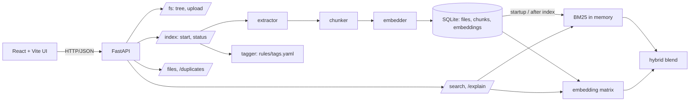

# 🔎 Smart Document Search & Organizer

A local web app that indexes the documents in a folder on your PC and lets you search them three ways —
**keyword (BM25)**, **semantic (embeddings)** and **hybrid** — auto-tags them with editable rules, finds
duplicates, and **explains why** each result ranked where it did. No LLM, no cloud, no paid APIs.

> Project 1 of 5 in a learning series (search → classifier → GenAI studio → RAG chatbot → agent).

<!-- screenshots: docs/img/search.png, docs/img/explain.png, docs/img/duplicates.png -->
| Search | Explain drawer | Duplicates |
|---|---|---|
| _screenshot placeholder_ | _screenshot placeholder_ | _screenshot placeholder_ |

## Architecture



## Prerequisites
- Python 3.11+ and Node 20+
- (Recommended) `pip install sentence-transformers` for real semantic search. Without it the app falls back to a
  lexical "hashing" embedder and says so on the Settings page. **Ollama is not needed for this project.**

## Quick start (Windows PowerShell)

```powershell
git clone https://github.com/kamalnathmurugan14/smart-doc-search; cd smart-doc-search

# backend
cd backend
python -m venv .venv; .\.venv\Scripts\Activate.ps1
pip install -r requirements.txt
# pip install sentence-transformers      # optional, enables real semantic search (~90 MB model download)
copy .env.example .env                   # then edit DOCS_ROOT=C:/Users/you/Documents/docs
uvicorn app.main:app --reload            # http://localhost:8000/docs

# frontend (new terminal)
cd frontend
npm install
npm run dev                              # http://localhost:5173
```
macOS/Linux: `source .venv/bin/activate` and `cp .env.example .env`.
Open the UI → **Settings → Re-index** → **Search**. `backend/sample_docs/` has a few files to try first.

## Configuration (`backend/.env`)

| Variable | Default | Meaning |
|---|---|---|
| `DOCS_ROOT` | `./sample_docs` | Folder to index (the only place files are read from / uploaded to) |
| `DATA_DIR` | `./data` | SQLite index location (git-ignored) |
| `MAX_UPLOAD_MB` | `25` | Upload size limit |
| `ALLOWED_EXTENSIONS` | `pdf,docx,txt,md` | Extension allow-list |
| `EMBEDDING_MODEL` | `sentence-transformers/all-MiniLM-L6-v2` | Model name, or `hashing` for the offline fallback |
| `CHUNK_SIZE_CHARS` / `CHUNK_OVERLAP_CHARS` | `1000` / `150` | Chunking |
| `HYBRID_ALPHA` | `0.5` | Semantic weight in hybrid mode (0 = keyword only) |
| `DUP_NEAR_THRESHOLD` | `0.92` | Cosine threshold for near-duplicates |
| `DUP_JACCARD_MIN` | `0.5` | Shingle-overlap confirmation for near-duplicates |
| `CORS_ORIGINS` | `http://localhost:5173` | Allowed browser origins |
| `TAG_RULES_PATH` | `./rules/tags.yaml` | Auto-tag rules (edit without code changes) |

## API overview
Full interactive docs at `/docs`; exported spec in [`docs/openapi.json`](docs/openapi.json). Errors always look like
`{"error": {"code": "…", "message": "…"}}`.

| Endpoint | Purpose |
|---|---|
| `GET /health` | `{status, version, embedder}` |
| `GET /fs/tree?path=` · `POST /fs/upload` | Browse / upload inside `DOCS_ROOT` (path-safe) |
| `POST /index {force}` → 202 · `GET /index/status` | Incremental indexing + progress |
| `GET /search?q=&mode=&top_k=&alpha=&tags=` | Ranked results, one best chunk per file |
| `GET /explain?q=&chunk_id=` | Term contributions, cosine, hybrid formula |
| `GET /files?tag=&ext=` · `POST /files/retag` · `GET /duplicates` | Metadata, tags, duplicates |

## Security notes
Every path goes through `safe_resolve()` (rejects `..`, absolute paths, drive letters, escaping symlinks);
uploads are extension-allow-listed, size-limited, sanitized and never overwrite; CORS is limited to the Vite
origin; document text is never logged at INFO. Covered by tests in `backend/tests/test_paths_and_fs.py`.

## Testing
```bash
make test                          # or: .\scripts\test.ps1 on Windows
cd backend && pytest --cov=app     # 40 tests, ~93% coverage
cd frontend && npm run test:all    # lint + typecheck + vitest + build
cd frontend && npm run test:e2e    # Playwright smoke test (starts its own backend)
python backend/scripts/perf_check.py 500   # 500 docs: index ≈ 2.5 s, search ≈ 3 ms (hashing embedder)
```
Tests never download a model: they inject a tiny synonym-aware embedder to prove the semantic path.

## Troubleshooting
- **"Cannot reach the backend"** – start uvicorn; check `VITE_API_URL` (default `http://localhost:8000`).
- **Embedder says `hashing`** – `sentence-transformers` is missing or the model couldn't download; semantic search is only lexical until fixed. After installing it, click *Force full re-index*.
- **PDF shows `no_text`** – it is probably scanned images; OCR is out of scope.
- **Nothing found** – did you click Re-index after adding files?

## Roadmap
OCR for scanned PDFs · query-time filters by folder/date · saved searches · keep the explorer in sync via file watching.

See also: [Architecture](docs/ARCHITECTURE.md) · [Learning notes](docs/LEARNING_NOTES.md) · [Demo script](docs/DEMO.md)
